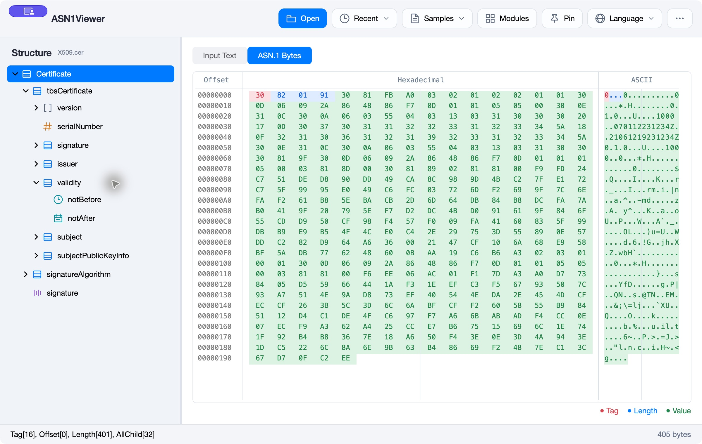

# ASN1Viewer

A lightweight and fast ASN.1 data viewer, built in C# with Windows (WinForms) and macOS (Avalonia) interfaces. Parses ASN.1 data or files(*.pfx, .p7b, *.pem, *.cer, *.der, etc) and displays it in a tree view.

## Features
- 🧬 Parses DER-encoded, PEM-encoded, HEX-encoded ASN.1
- 🌳 Tree-view UI
- 🪟 Windows UI built with WinForms
- 🍎 macOS UI built with Avalonia
- 📦 Simple executable, no install needed

## Screenshots

## Windows: Getting Started
1. Clone repo
2. Open in Visual Studio
3. Build and run
4. Open sample(Test) files

5. There are 3 ways to open ASN.1 data(file)
  - By menu (File->Open)
  - Drag the file into the Form
  - Input PEM text or HEX text in the **"Input Text"** tab

  

## Use cases
- Inspect X.509 certificates
- Analyze PKCS structures
- Debug ASN.1-based protocols

## macOS

Inspect certificates, keys, and other ASN.1 data in a macOS-style interface with
a structure sidebar, an action bar, and synchronized text and byte views.
Available for both Apple Silicon and Intel Macs running macOS 12 or newer.

### Download and open

1. Open [Releases](https://github.com/JoeLiu2015/ASN1Viewer/releases) and choose the ZIP for your Mac:
   - **Apple Silicon (M-series):** `ASN1Viewer-osx-arm64.zip`
   - **Intel:** `ASN1Viewer-osx-x64.zip`
2. Extract the ZIP and move **ASN1Viewer.app** to Applications.
3. Open **ASN1Viewer**. The download includes the runtime; no separate .NET installation is needed.

The macOS builds are currently ad-hoc signed, not Apple-notarized.

### Open ASN.1 data

- Click **Open** to select a certificate, key, or other ASN.1 file, or drag a file into the window.
- Paste **PEM, Base64, or hexadecimal text** into **Input Text**. The structure updates automatically as you type.
- Choose **Samples** to explore the bundled X.509, PKCS, and other examples.
- Use **Recent** to reopen a previously viewed file.

### Explore the structure and bytes

Expand nodes in the left sidebar to inspect their ASN.1 types and values.
Distinct node icons help identify different types. Selecting a node opens
**ASN.1 Bytes** and scrolls to its location in the document.

The byte view shows **Offset**, **Hexadecimal**, and **ASCII** columns. Colors
identify the selected node's tag (red), length (blue), and value (green).
Light dividers separate columns and groups of eight bytes. The status bar shows
the selected node's offset and length. Switch back to **Input Text** to view or
change the text input.

### Edit and inspect further

Right-click a node to expand or collapse its children, copy its text or bytes,
edit a leaf value, or parse embedded ASN.1 content. Editing a value updates the
structure and byte view, including parent lengths when the value changes size.
Click **Modules** to browse the bundled ASN.1 definitions and their structure.

### Make it your own

- **Pin** keeps the window above other applications.
- **Language** switches between English and Simplified Chinese. The first launch uses English; subsequent launches restore your saved choice.
- Drag the divider beside the sidebar to give the structure or byte view more room.
- Open **More (•••) → About** to see the full version number and build date.

Files and text input are limited to 16 MiB. To update the app, download a newer
build from Releases; automatic updates are not enabled.

## License

MIT
